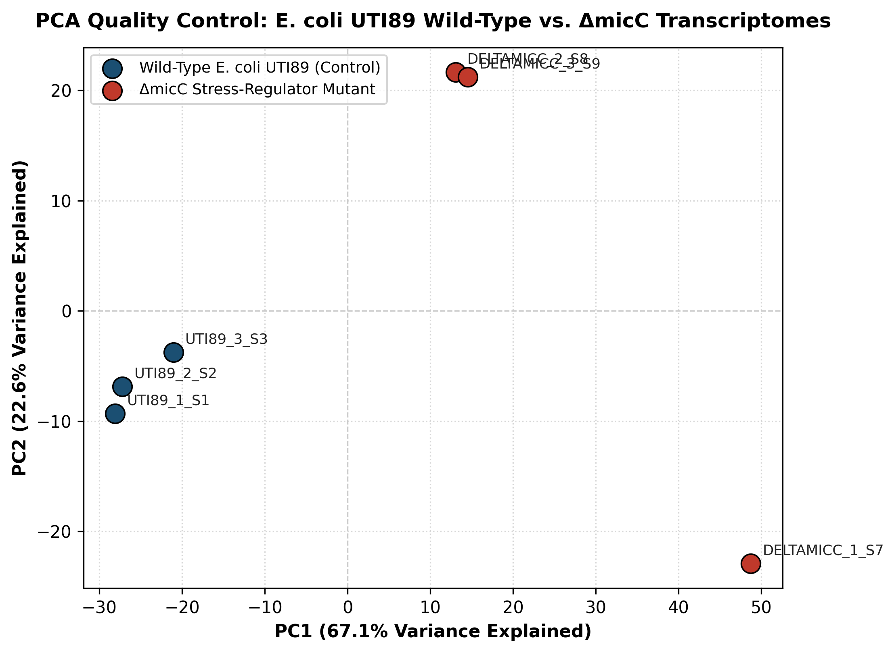
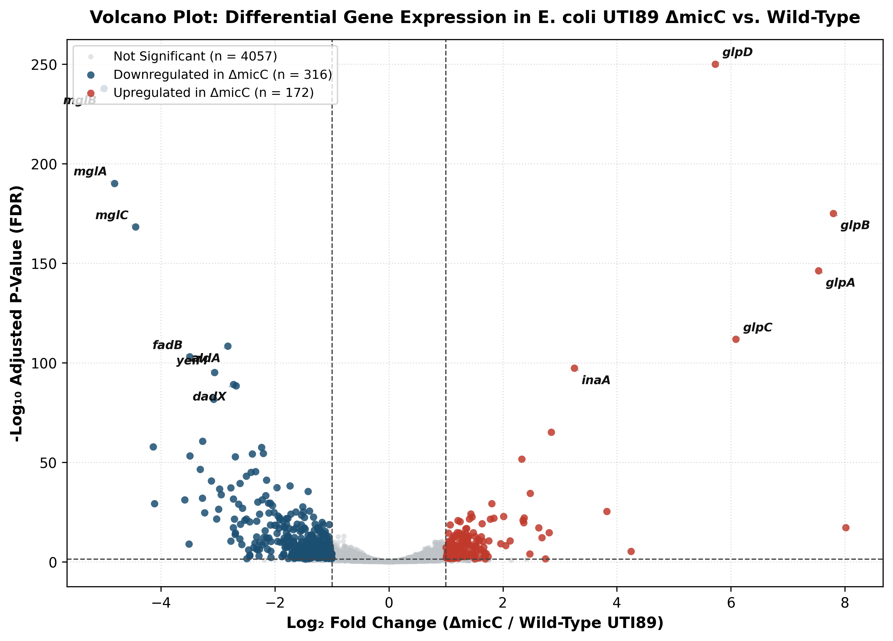
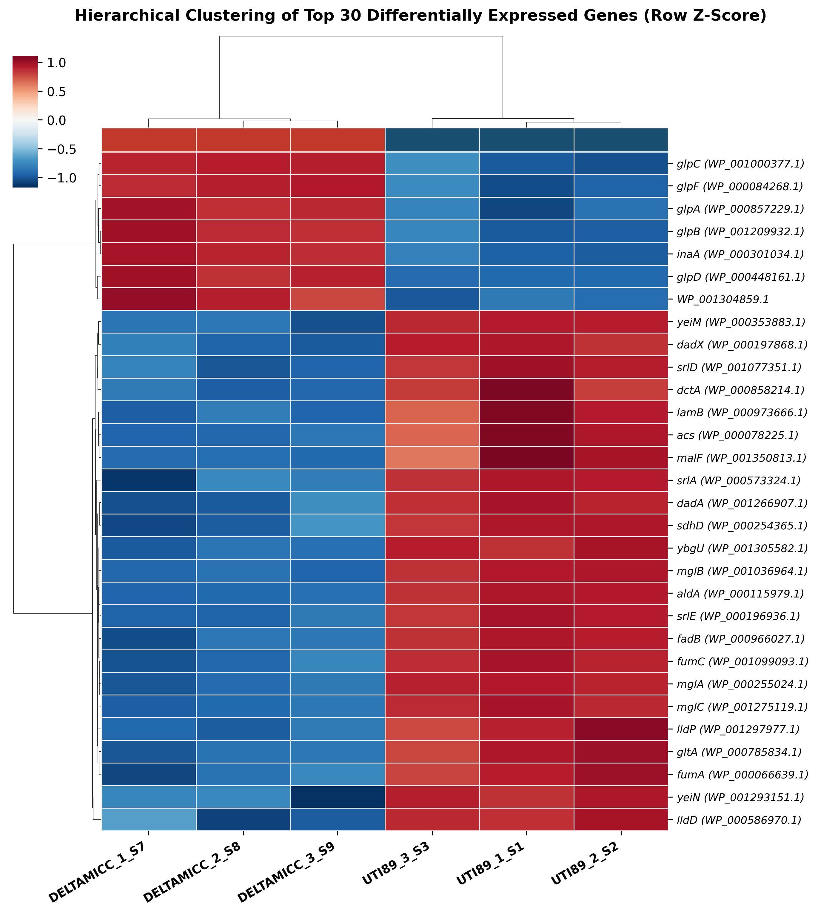
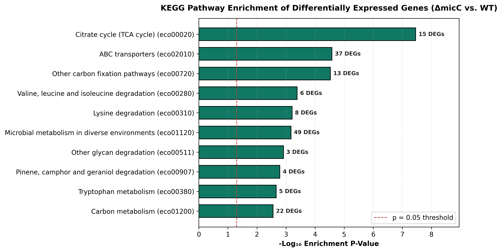

# Bacterial Stress Transcriptomics: Differential Gene Expression in *E. coli* UTI89 (ΔmicC)

## Overview
A complete bulk RNA-Seq transcriptomics pipeline analyzing genome-wide transcriptional reprogramming in Extraintestinal Pathogenic *Escherichia coli* (**strain UTI89**) following deletion of the stress-response small non-coding RNA **MicC** (`NCBI GEO: GSE337028`).

## Pipeline & Methods
1. **Raw Count Retrieval (`NCBI GEO / Biopython`):** Fetched raw unnormalized read counts (`4,764 genes × 6 samples`: 3 Wild-Type `UTI89` controls vs. 3 `ΔmicC` knockout replicates) and filtered low-count background noise (`≥ 10` total reads across samples, retaining `4,636` expressed genes).
2. **Quality Control & Normalization (`PyDESeq2` & `scikit-learn`):** Applied median-of-ratios size-factor normalization and Principal Component Analysis (PCA) on $\log_2$-transformed counts.
3. **Differential Expression Modeling (`PyDESeq2`):** Estimated gene-wise dispersions and performed Wald hypothesis testing (`FDR < 0.05` and $|\log_2\text{Fold Change}| \ge 1.0$).
4. **Annotation & Pathway Enrichment (`UniProt REST API` & `GSEApy`):** Mapped RefSeq protein accessions to official *E. coli* gene symbols and performed over-representation analysis against *E. coli* KEGG pathways.

## Key Biological Findings
* **Strong Genotype Separation on PCA:** PC1 (`67.1%`) and PC2 (`22.6%`) explain **89.7%** of total transcriptome variance, cleanly separating Wild-Type and `ΔmicC` replicates.
* **488 Differentially Expressed Genes:** Deletion of `micC` significantly alters **488 genes** (**172 upregulated** and **316 downregulated**).
* **Carbon & Envelope Stress Reprogramming:** Loss of `micC` strongly induces the glycerol-3-phosphate metabolism regulon (`glpB` +7.80 $\log_2$FC, `glpA` +7.54, `glpC` +6.09, `glpD` +5.73, `glpF` +2.85) and the pH/envelope stress-inducible LPS kinase `inaA` (+3.26 $\log_2$FC), while repressing the galactose ABC transporter operon (`mglB` -5.00, `mglA` -4.81, `mglC` -4.44), fatty acid oxidation (`fadB` -3.50), and citrate synthase (`gltA` -3.07).

## Repository Contents
* `02_Bacterial_Stress_RNAseq.ipynb` — Complete Google Colab Python workflow
* `deseq2_results_annotated.csv` — Full statistical differential expression table (`PyDESeq2` + UniProt annotations)
* `kegg_pathway_enrichment.csv` — Enriched *E. coli* KEGG pathways (`GSEApy`)
* `pca_qc_plot_300dpi.png` — Sample PCA quality control plot
* `volcano_plot_300dpi.png` — Differential expression volcano plot
* `heatmap_top30_degs_300dpi.png` — Hierarchically clustered Z-score heatmap of top 30 DEGs
* `pathway_enrichment_300dpi.png` — Top enriched KEGG pathways

## Key Figures

