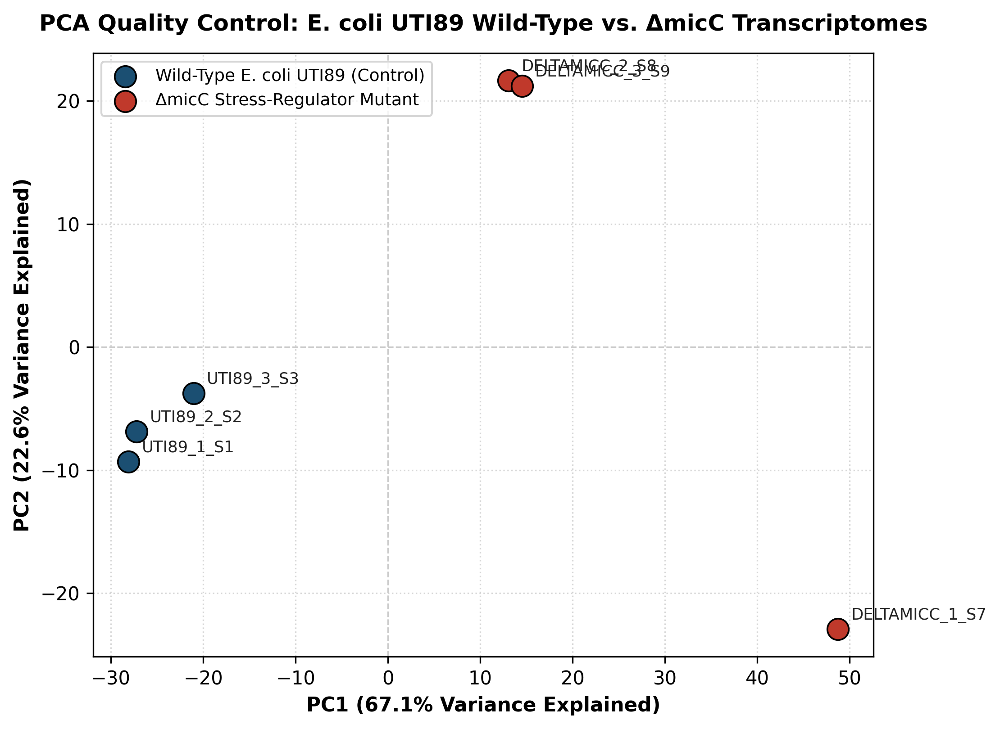
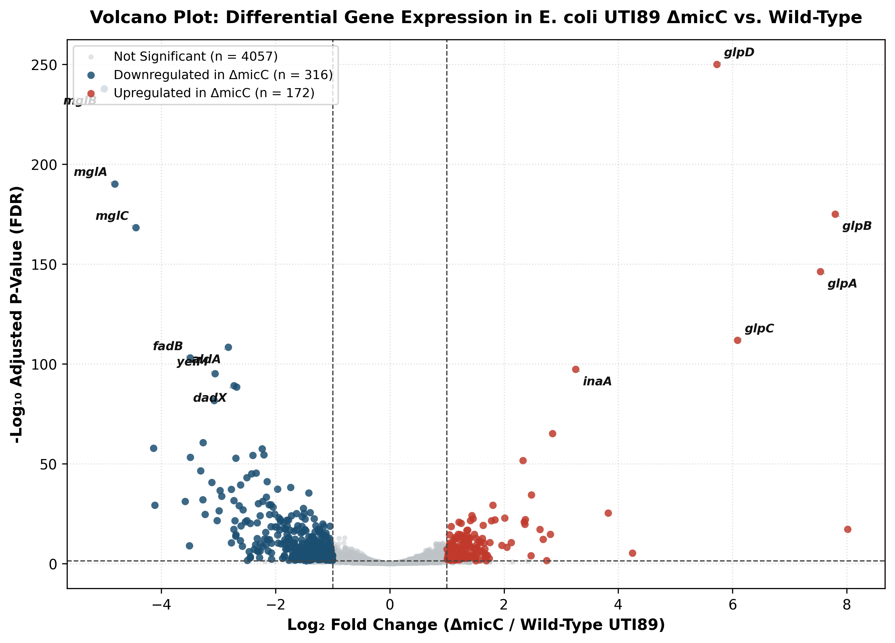
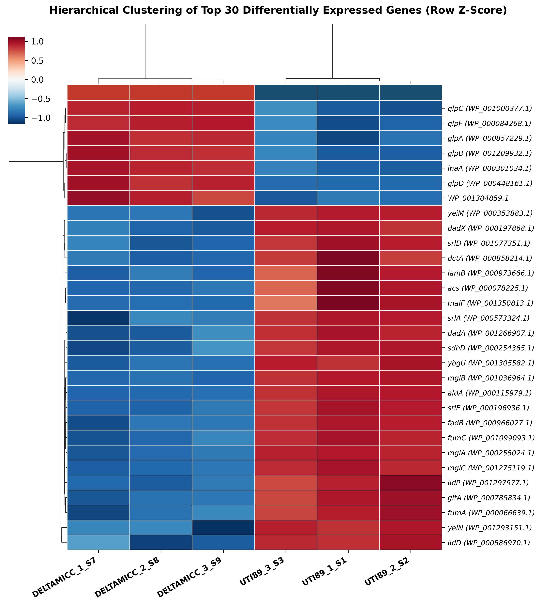
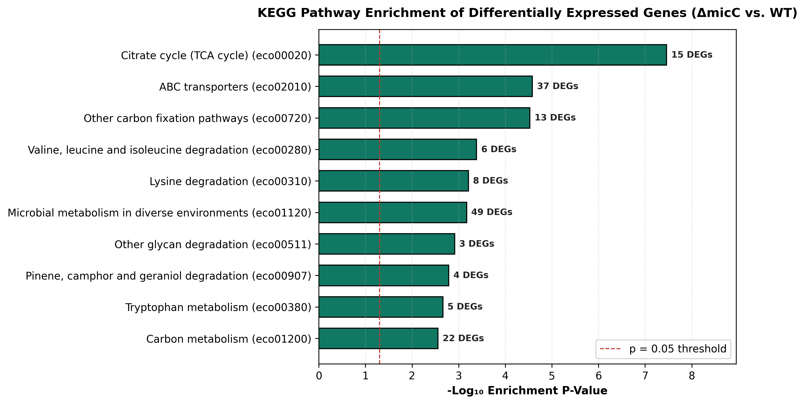

# Bacterial Stress Transcriptomics: Differential Gene Expression in *E. coli* UTI89 (ΔmicC)

## Background & Objective
Bacteria survive hostile host and environmental stresses by rapidly reprogramming gene transcription, often through small non-coding regulatory RNAs (sRNAs). **MicC** is a well-characterized sRNA in *Escherichia coli* that modulates outer-membrane porin expression and envelope stress responses.

In this project, I built an end-to-end bulk RNA-Seq pipeline in Python to analyze how deleting `micC` ($\Delta micC$) reshapes genome-wide expression and metabolic pathways in Extraintestinal Pathogenic *E. coli* (**strain UTI89**), using raw sequencing counts from **NCBI GEO (`GSE337028`)**.

## Workflow
1. **Raw Count Retrieval & Filtering (`Biopython` & `pandas`):** Retrieved the raw unnormalized count matrix (`4,764 genes × 6 samples`: 3 wild-type `UTI89` controls and 3 `ΔmicC` knockout replicates) from NCBI GEO and filtered out low-count background noise (`≥ 10` total reads across samples, retaining `4,636` expressed genes).
2. **Quality Control & Normalization (`PyDESeq2` & `scikit-learn`):** Applied median-of-ratios size-factor normalization and Principal Component Analysis (PCA) on $\log_2$-transformed counts to verify replicate clustering.
3. **Differential Expression Analysis (`PyDESeq2`):** Estimated gene-wise dispersions and performed Negative Binomial Wald testing (`FDR < 0.05` and $|\log_2\text{Fold Change}| \ge 1.0$).
4. **Gene Annotation & Pathway Enrichment (`UniProt REST API` & `GSEApy`):** Mapped RefSeq protein accessions (`WP_...`) to official *E. coli* gene symbols and ran KEGG pathway over-representation analysis.

## Key Findings
* **Clear Genotype Separation on PCA:** PC1 (`67.1%`) and PC2 (`22.6%`) account for **89.7%** of total transcriptome variance, separating wild-type and `ΔmicC` replicates into two distinct clusters.
* **488 Differentially Expressed Genes:** Loss of `micC` significantly alters **488 genes** (**172 upregulated** and **316 downregulated**).
* **Carbon Shift & Envelope Stress Response:**Deletion of micC strongly induces the glycerol-3-phosphate metabolism regulon (glpB +7.80, glpA +7.54, glpC +6.09, glpD +5.73, glpF +2.85; values in log₂ fold change) and the envelope/pH stress-inducible LPS kinase inaA (+3.26), while repressing the galactose ABC transporter operon (mglB -5.00, mglA -4.81, mglC -4.44), fatty acid oxidation (fadB -3.50), and citrate synthase (gltA -3.07).
* **Enriched KEGG Pathways:** Over-representation analysis highlights significant enrichment in the **Citrate cycle / TCA cycle (`eco00020`, `padj = 3.0e-6`)**, **ABC transporters (`eco02010`, `padj = 8.71e-4`)**, and **Microbial metabolism in diverse environments (`eco01120`, `padj = 0.0099`)**.

## Files in This Repository
* `02_Bacterial_Stress_RNAseq.ipynb` — Google Colab notebook with the complete Python workflow
* `GSE337028_all_counts_KO.tsv.gz` — Raw NCBI GEO gene-count matrix
* `deseq2_results_annotated.csv` — Full `PyDESeq2` statistical results with UniProt gene symbols
* `kegg_pathway_enrichment.csv` — Enriched *E. coli* KEGG pathways (`GSEApy`)
* `pca_qc_plot_300dpi.png` — Sample PCA quality control plot
* `volcano_plot_300dpi.png` — Differential expression volcano plot
* `heatmap_top30_degs_300dpi.png` — Hierarchically clustered Z-score heatmap of top 30 DEGs
* `pathway_enrichment_300dpi.png` — Top 10 enriched KEGG pathways

## Figures

### Sample Quality Control (PCA)

### Differential Gene Expression (Volcano Plot)

### Hierarchical Clustering of Top 30 DEGs

### KEGG Pathway Enrichment

